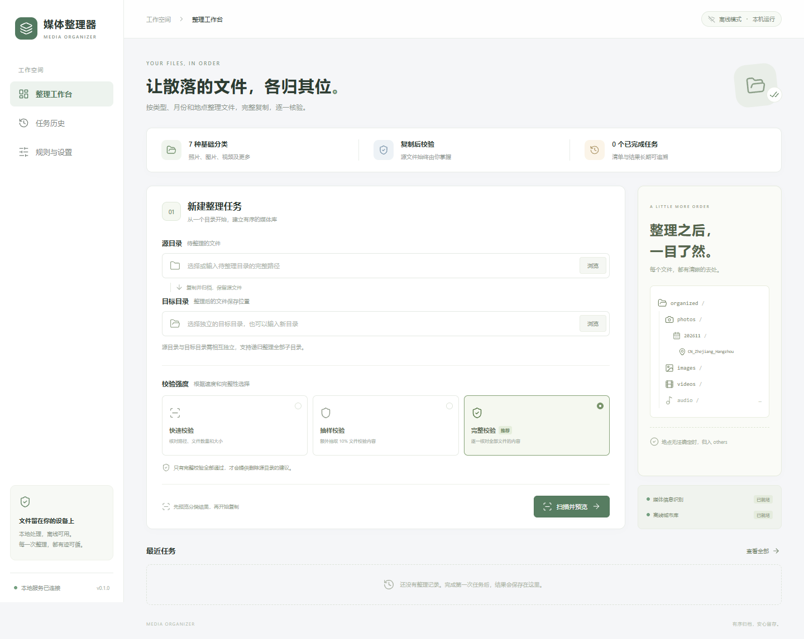

# Media Organizer · 媒体整理器

Windows / Linux 离线文件整理工具。支持预览修正、任务恢复和内容校验。

## 使用

在 [GitHub Releases](https://github.com/low-key-sapling/media-organizer/releases/latest) 下载对应平台的压缩包。解压后启动 `media-organizer.exe`（Windows）或 `./media-organizer`（Linux）。程序自动打开本地浏览器，网页、运行时、元数据工具与城市库均随包提供。

选择源目录与独立的目标目录，先扫描预览，再复制并校验。文档按 `documents/YYYYMM/后缀/文件名` 归档，例如 `documents/202611/pdf/合同.PDF`。照片等按 `类型/YYYYMM/地点/文件名` 归档，地点未知时使用 `others`。

支持照片、图片、视频、音频、文档、压缩包和其他文件。允许批量修正分类，支持同名文件保留、中断恢复、任务历史、CSV 导出和配置导入导出。

| 校验级别 | 内容 | 删除源目录提示 |
| --- | --- | --- |
| 快速 | 对应关系、文件存在性与大小 | 不提供 |
| 抽样 | 快速检查 + 随机 10% 文件的 SHA-256 | 不提供 |
| 完整（默认） | 全部文件的 SHA-256 与附加用户数据 | 完全通过且没有未处理项时提供 |

提示只针对本次校验时点。分类准确性需在预览中确认；程序没有删除源目录的功能。



## 文档

- [使用说明](docs/使用说明.md)
- [开发与构建](docs/开发与构建.md)
- [第三方资源及许可](THIRD_PARTY_NOTICES.md)

## 开发

Python 3.12+、Node 22+ 仅为构建时依赖。

```text
python -m venv .venv
python -m pip install -e ".[dev]"
python scripts/prepare_resources.py
cd frontend
npm ci --legacy-peer-deps
npm run build
cd ..
python -m media_organizer serve
```

以上 Python 命令请使用虚拟环境中的解释器。验证运行 `python -m pytest -q`；两端构建流程见 `.github/workflows/release.yml`。

首版兼容目标：Windows x64；Linux x64 / glibc，以 Ubuntu 22.04 及更新 LTS 为验证基线。实际构建与验收状态记录在交付报告中；Windows 包不能作为 Linux 包使用。
